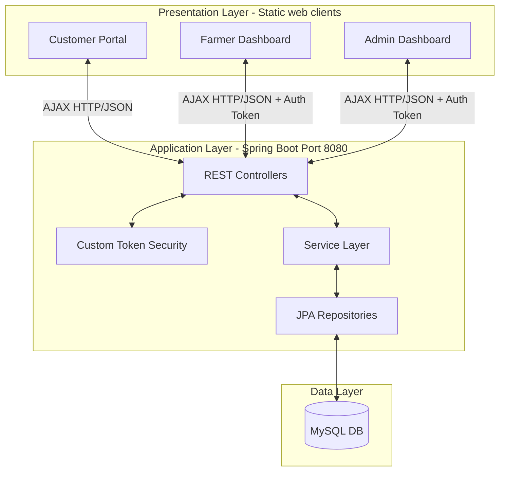
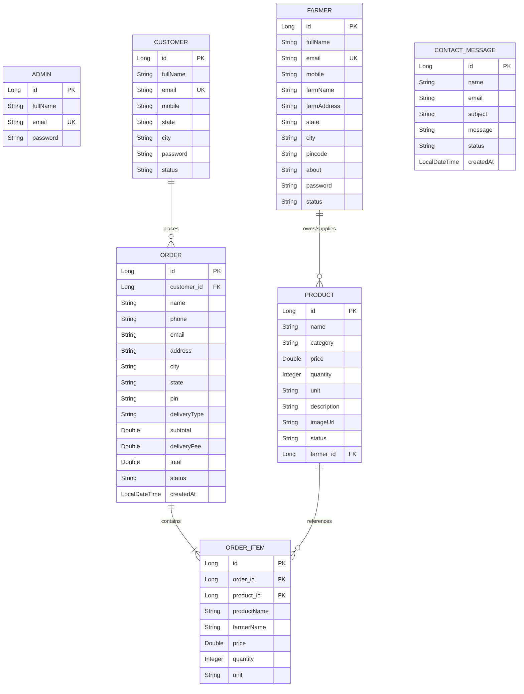

# Farm-Fresh: Direct-to-Consumer Agricultural E-Commerce System
## Technical Documentation & Developer Guide

---

## Table of Contents
1. [Project Overview & Architecture](#1-project-overview--architecture)
2. [Technology Stack & File Directory](#2-technology-stack--file-directory)
3. [Database Design & Entity Relationships](#3-database-design--entity-relationships)
4. [Security & Custom Authentication System](#4-security--custom-authentication-system)
5. [REST API Documentation (Endpoints)](#5-rest-api-documentation-endpoints)
6. [Frontend Subsystems & Client Logic](#6-frontend-subsystems--client-logic)
7. [Configuration, Installation & Deployment](#7-configuration-installation--deployment)

---

## 1. Project Overview & Architecture

**Farm-Fresh** is an e-commerce platform designed to bridge the gap between local farmers and end-consumers. By removing intermediaries, the system enables farmers to list fresh produce (vegetables, fruits, grains, and dairy) directly for sale, set their own prices, and manage received orders. Customers benefit from fresh produce sourced directly from farms, with the convenience of guest checkouts or registered customer tracking. A central Administrator panel provides moderation, approval mechanisms, platform statistics, and customer support ticket handling.

### 1.1 Architectural Design
The project utilizes a standard **Three-Tier Client-Server Architecture** designed to isolate presentation, application logic, and data storage:

1. **Presentation Layer (Frontend)**: Consists of static HTML5 pages, CSS3 stylesheets, and vanilla JavaScript files. Client-side state (like the shopping cart) is managed using `localStorage`, and interface data binding is executed using asynchronous AJAX requests via the browser's `fetch` API.
2. **Application Layer (Backend)**: Built on the **Spring Boot** framework (Java 25). It uses the Model-View-Controller (MVC) pattern to serve RESTful endpoints, perform data validations, implement business workflows, and coordinate database transactions.
3. **Data Layer (Database)**: Relies on a relational **MySQL** database accessed via **Spring Data JPA** and **Hibernate ORM**.



---

## 2. Technology Stack & File Directory

### 2.1 Technology Stack Specs
* **Backend Framework**: Spring Boot 3.5.5
* **Java Version**: JDK 25
* **Build Automation & Dependency Manager**: Apache Maven
* **Database Driver**: MySQL Connector/J (`com.mysql:mysql-connector-j`)
* **Persistence Layer**: Spring Data JPA with Hibernate
* **Security & Crypto**: Spring Security (Core libraries utilized for BCrypt password encoding)
* **Frontend Languages**: HTML5, Vanilla CSS3, Vanilla ES6 JavaScript
* **API Communication Protocol**: JSON over HTTP REST APIs

### 2.2 Directory Structure
The repository organizes resources logically into backend source packages and frontend web folders:

```
Farm-Fresh/
│
├── pom.xml                               # Maven Project Object Model (dependencies & plugins)
├── dependency-list.txt                   # Flat list of compiled project dependencies
├── application.properties                # Spring application configuration (port, MySQL connection)
│
└── src/
    ├── main/
    │   ├── java/
    │   │   └── com/
    │   │       ├── backend/
    │   │       │   ├── FarmfreshApplication.java     # Main Spring Boot Entry Point
    │   │       │   ├── config/                       # CORS, Security, and Password Configurations
    │   │       │   ├── controller/                   # REST API Controllers (endpoints)
    │   │       │   ├── dto/                          # Request payloads and Response structures
    │   │       │   ├── entity/                       # JPA Entity classes (Database models)
    │   │       │   ├── exception/                    # Global Exception Handler and custom API Exceptions
    │   │       │   ├── repository/                   # JPA Repositories (Database Access Objects)
    │   │       │   ├── security/                     # Custom Session Token validation store
    │   │       │   └── seed/                         # Data Seeder for default admin accounts
    │   │       │
    │   │       └── com/frontend/                     # Frontend client folders
    │   │           ├── admin/                        # Admin panel screens, common utilities, and api configurations
    │   │           ├── farmer/                       # Farmer dashboard screens
    │   │           └── user/                         # Customer portal, shop catalog, cart, login, and feedback
    │   │
    │   └── resources/
    │       └── application.properties                # Symbolic resource link/copy of main configs
    │
    └── test/                                         # Unit/Integration tests
```

---

## 3. Database Design & Entity Relationships

The relational model utilizes 7 database tables mapped to JPA entities. Cascade rules are defined to preserve the referential integrity of orders when products or customers change.

### 3.1 Entity-Relationship Diagram (ERD)



### 3.2 Data Dictionary

#### 3.2.1 `customers` Table
Stores details of registered buyers.
* `id` (BIGINT, Primary Key, Auto-Increment): Unique identifier for the customer.
* `fullName` (VARCHAR, Not Null): Full name of the user.
* `email` (VARCHAR, Unique, Not Null): Login credential email.
* `mobile` (VARCHAR, Not Null): Mobile number.
* `state` / `city` (VARCHAR, Nullable): Location address fields.
* `password` (VARCHAR, Not Null): BCrypt hashed password.
* `status` (VARCHAR, Not Null, Default: `"ACTIVE"`): Block status (`"ACTIVE"` / `"BLOCKED"`).

#### 3.2.2 `farmers` Table
Stores registered seller accounts.
* `id` (BIGINT, Primary Key, Auto-Increment): Unique identifier for the farmer.
* `fullName` (VARCHAR, Not Null): Name of the farmer.
* `email` (VARCHAR, Unique, Not Null): Login credential email.
* `mobile` (VARCHAR, Not Null): Mobile number.
* `farmName` (VARCHAR): Name of the farm.
* `farmAddress` (VARCHAR, Max 500): Physical address.
* `state` / `city` / `pincode` (VARCHAR): Location details.
* `about` (VARCHAR, Max 1000): Farmer biography or details.
* `password` (VARCHAR, Not Null): BCrypt hashed password.
* `status` (VARCHAR, Not Null, Default: `"ok"`): Moderation status (`"ok"` [Approved] / `"pending"` / `"blocked"`).

#### 3.2.3 `products` Table
Active items listed by approved farmers.
* `id` (BIGINT, Primary Key, Auto-Increment): Unique identifier for the product.
* `name` (VARCHAR, Not Null): Display name of the product.
* `category` (VARCHAR): e.g., vegetables, fruits, grains, dairy.
* `price` (DOUBLE, Not Null): Unit price.
* `quantity` (INT, Not Null): Available stock count.
* `unit` (VARCHAR): Measurement unit (e.g., kg, dozen, litre).
* `description` (VARCHAR, Max 1000): Item description.
* `imageUrl` (VARCHAR): URL path for the product image.
* `status` (VARCHAR, Not Null, Default: `"ok"`): Access flag (`"ok"` [Active] / `"inactive"`).
* `farmer_id` (BIGINT, Foreign Key referencing `farmers(id)`): Supplier linking constraint.

#### 3.2.4 `orders` Table
General checkout records. Allows both guest and logged-in buyer records.
* `id` (BIGINT, Primary Key, Auto-Increment): Unique identifier for the order.
* `customer_id` (BIGINT, Foreign Key referencing `customers(id)`, Nullable): Empty if guest checkout.
* `name` / `phone` / `email` (VARCHAR, Not Null): Direct recipient contact details.
* `address` (VARCHAR, Max 500, Not Null): Shipping location.
* `city` / `state` / `pin` / `deliveryType` (VARCHAR): Shipping details.
* `subtotal` / `deliveryFee` / `total` (DOUBLE): Financial breakdown sums.
* `status` (VARCHAR, Not Null, Default: `"Pending"`): Lifecycle status (`"Pending"`, `"Confirmed"`, `"Shipped"`, `"Delivered"`, `"Cancelled"`).
* `createdAt` (DATETIME, Not Null): Order placement timestamp.

#### 3.2.5 `order_items` Table
Transactional snapshots of purchase configurations.
* `id` (BIGINT, Primary Key, Auto-Increment): Unique line item identifier.
* `order_id` (BIGINT, Foreign Key referencing `orders(id)`, Cascade On Delete): Link to parent order.
* `product_id` (BIGINT, Foreign Key referencing `products(id)`, Nullable): Prevents cascade breaks if product is deleted.
* `productName` (VARCHAR, Not Null): Historical product name snapshot.
* `farmerName` (VARCHAR): Historical farmer name snapshot.
* `price` (DOUBLE, Not Null): Snapshot price at purchase.
* `quantity` (INT, Not Null): Ordered quantity.
* `unit` (VARCHAR): Measurement unit snapshot.

#### 3.2.6 `contact_messages` Table
Tracks user inquiries submitted through the contact page.
* `id` (BIGINT, Primary Key, Auto-Increment): Unique message identifier.
* `name` / `email` / `subject` (VARCHAR, Not Null): Submitter info.
* `message` (VARCHAR, Max 2000, Not Null): The inquiry description.
* `status` (VARCHAR, Default: `"NEW"`): Read/process state (`"NEW"` / `"READ"` / `"RESOLVED"`).

---

## 4. Security & Custom Authentication System

To simplify standard Spring Security operations and make it highly transparent for maintenance and walkthroughs, the system integrates a custom **Token-Based Session Store**. 

While Spring Security configurations disable CSRF, enable CORS, and allow public resource loading (`.anyRequest().permitAll()`), all internal API access control is managed explicitly in service code using a custom `TokenStore`.

```
Authorization Header (Client request) 
  --> Resolved by SecurityConfig (Public permitAll) 
  --> Parsed manually inside REST Controller / Service via tokenStore.resolve() 
  --> Verified roles / permissions
```

### 4.1 Token Store Logic (`TokenStore.java`)
1. **Token Generation**: On successful authentication, the backend generates a random `UUID` string.
2. **Session Store**: The token and its corresponding `AuthPrincipal` details are stored in an in-memory `ConcurrentHashMap`.
3. **Session Lifespan**: Sessions persist for the duration of the server run lifecycle (restarting the backend invalidates active tokens, ideal for lightweight deployments).
4. **Token Resolution**: The backend strips the `"Bearer "` prefix from request headers and fetches the `AuthPrincipal` from the internal map.

```java
public class AuthPrincipal {
    public final Long id;
    public final String role;     // "customer", "farmer", or "admin"
    public final String email;
    public final String fullName;
}
```

### 4.2 Permission Guards (`AuthService.java`)
Endpoints use manual checks to enforce security constraints rather than annotation interceptors:
* `requireAuth(authHeader)`: Validates that the token exists and resolves to a valid user session. Throws `HttpStatus.UNAUTHORIZED` (401) on failure.
* `requireRole(authHeader, role)`: Resolves session authentication, and checks if `principal.role` matches the expected string. Throws `HttpStatus.FORBIDDEN` (403) on failure.

---

## 5. REST API Documentation (Endpoints)

All APIs communicate via JSON request payloads and return JSON structured responses. Standard error payloads include a `message` and `timestamp`.

### 5.1 Authentication Module (`/api/auth`)

* **POST** `/api/auth/register/customer`
  * *Description*: Registers a customer account. Returns credentials and token.
  * *Request Body (`RegisterCustomerRequest`)*:
    ```json
    { "fullName": "Jane Doe", "email": "jane@example.com", "mobile": "9876543210", "state": "Delhi", "password": "password123" }
    ```
  * *Response (`AuthResponse`)*: `200 OK`
    ```json
    { "token": "c7a8b411-cf0b-4b20-9118-d06981881abf", "role": "customer", "id": 1, "fullName": "Jane Doe", "email": "jane@example.com" }
    ```

* **POST** `/api/auth/register/farmer`
  * *Description*: Registers a farmer account. Needs verification by admin before listing items.
  * *Request Body (`RegisterFarmerRequest`)*:
    ```json
    { "fullName": "John Smith", "email": "john@example.com", "mobile": "9123456789", "farmName": "Smith Farms", "farmAddress": "Address Road", "state": "Punjab", "password": "farmerpassword" }
    ```
  * *Response (`AuthResponse`)*: `200 OK` containing a generated token.

* **POST** `/api/auth/login`
  * *Description*: Authenticates credentials for any role. Checks user status block flags.
  * *Request Body (`LoginRequest`)*:
    ```json
    { "email": "jane@example.com", "password": "password123", "role": "customer" }
    ```
  * *Response (`AuthResponse`)*: `200 OK` containing session details.

* **POST** `/api/auth/logout`
  * *Description*: Invalidates and removes the session token from the memory store.
  * *Headers*: `Authorization: Bearer <token>`
  * *Response*: `200 OK` (No Content)

---

### 5.2 Product Management Module (`/api/products` and `/api/farmer/products`)

* **GET** `/api/products`
  * *Description*: Public shop interface retrieval. Returns only products marked with status `"ok"`.
  * *Response*: `List<ProductResponse>`

* **GET** `/api/farmer/products`
  * *Description*: Lists all products belonging to the logged-in farmer.
  * *Headers*: `Authorization: Bearer <farmer_token>`
  * *Response*: `List<ProductResponse>`

* **POST** `/api/farmer/products`
  * *Description*: Adds a new product to the farmer's catalog.
  * *Headers*: `Authorization: Bearer <farmer_token>`
  * *Request Body (`ProductRequest`)*:
    ```json
    { "name": "Organic Tomatoes", "category": "vegetables", "price": 40.0, "quantity": 100, "unit": "kg", "description": "Fresh vine tomatoes", "imageUrl": "http://image-url" }
    ```
  * *Response (`ProductResponse`)*: `200 OK`

* **PUT** `/api/farmer/products/{id}`
  * *Description*: Modifies an existing product. Validates ownership.
  * *Headers*: `Authorization: Bearer <farmer_token>`
  * *Request Body (`ProductRequest`)*: Updates target field parameters.
  * *Response*: `ProductResponse`

* **DELETE** `/api/farmer/products/{id}`
  * *Description*: Removes a product listing.
  * *Headers*: `Authorization: Bearer <farmer_token>`
  * *Response*: `200 OK`

---

### 5.3 Checkout & Order Processing Module (`/api/orders`)

* **POST** `/api/orders`
  * *Description*: Processes checkout lists, creates orders/items, and decrements stock. Supports both registered and guest checkouts.
  * *Headers*: `Authorization: Bearer <customer_token>` (Optional)
  * *Request Body (`CheckoutRequest`)*:
    ```json
    {
      "name": "Jane Doe",
      "phone": "9876543210",
      "email": "jane@example.com",
      "address": "Green Colony",
      "city": "New Delhi",
      "state": "Delhi",
      "pin": "110011",
      "deliveryType": "Home Delivery",
      "deliveryFee": 50.0,
      "items": [
        { "productId": 1, "productName": "Organic Tomatoes", "price": 40.0, "quantity": 3, "unit": "kg" }
      ]
    }
    ```
  * *Response (`OrderResponse`)*: `200 OK`

* **GET** `/api/orders/mine`
  * *Description*: Retrieves order history for the authenticated customer.
  * *Headers*: `Authorization: Bearer <customer_token>`
  * *Response*: `List<OrderResponse>`

* **GET** `/api/farmer/orders`
  * *Description*: Retrieves all order items belonging to the logged-in farmer's products.
  * *Headers*: `Authorization: Bearer <farmer_token>`
  * *Response*: `List<OrderItemResponse>`

* **PUT** `/api/farmer/orders/{orderId}/status`
  * *Description*: Allows a farmer to update order status if the order contains their products.
  * *Headers*: `Authorization: Bearer <farmer_token>`
  * *Request Body*: `{ "status": "Shipped" }`
  * *Response*: `200 OK`

---

### 5.4 Administrator Operations Module (`/api/admin`)

* **GET** `/api/admin/dashboard`
  * *Description*: Fetches system metrics (Total Farmers, Customers, Orders, and Platform Revenue).
  * *Headers*: `Authorization: Bearer <admin_token>`
  * *Response*: `DashboardStats`

* **GET** `/api/admin/farmers`
  * *Description*: Lists all platform farmers with their product counts and total sales revenues.
  * *Headers*: `Authorization: Bearer <admin_token>`
  * *Response*: `List<AdminFarmerRow>`

* **PUT** `/api/admin/farmers/{id}/status`
  * *Description*: Approves (`"ok"`) or blocks (`"blocked"`) a farmer account.
  * *Headers*: `Authorization: Bearer <admin_token>`
  * *Request Body*: `{ "status": "ok" }`
  * *Response*: `FarmerResponse`

* **GET** `/api/admin/customers`
  * *Description*: Lists registered customers with their order count and total spend.
  * *Headers*: `Authorization: Bearer <admin_token>`
  * *Response*: `List<AdminCustomerRow>`

* **PUT** `/api/admin/customers/{id}/status`
  * *Description*: Block/Unblock customer status.
  * *Headers*: `Authorization: Bearer <admin_token>`
  * *Request Body*: `{ "status": "BLOCKED" }`
  * *Response*: `200 OK`

* **GET** `/api/admin/products`
  * *Description*: Retrieves all listed products in the system.
  * *Headers*: `Authorization: Bearer <admin_token>`
  * *Response*: `List<ProductResponse>`

* **PUT** `/api/admin/products/{id}/status`
  * *Description*: Changes status of a product (e.g., to deactivate offensive or invalid listings).
  * *Headers*: `Authorization: Bearer <admin_token>`
  * *Request Body*: `{ "status": "inactive" }`
  * *Response*: `ProductResponse`

* **GET** `/api/admin/orders`
  * *Description*: Retrieves all orders on the platform.
  * *Headers*: `Authorization: Bearer <admin_token>`
  * *Response*: `List<AdminOrderRow>`

* **PUT** `/api/admin/orders/{id}/status`
  * *Description*: Super-admin override to change order processing status.
  * *Headers*: `Authorization: Bearer <admin_token>`
  * *Request Body*: `{ "status": "Delivered" }`
  * *Response*: `OrderResponse`

* **GET** `/api/admin/messages`
  * *Description*: Lists all submitted contact form inquiries.
  * *Headers*: `Authorization: Bearer <admin_token>`
  * *Response*: `List<MessageResponse>`

* **PUT** `/api/admin/messages/{id}/status`
  * *Description*: Updates message state (e.g., `"READ"` or `"RESOLVED"`).
  * *Headers*: `Authorization: Bearer <admin_token>`
  * *Request Body*: `{ "status": "RESOLVED" }`
  * *Response*: `MessageResponse`

---

### 5.5 Support & Feedback Module (`/api/contact` and diagnostic endpoints)

* **POST** `/api/contact`
  * *Description*: Saves contact form inquiries. Publicly accessible.
  * *Request Body (`ContactRequest`)*:
    ```json
    { "name": "Visitor", "email": "visitor@example.com", "subject": "Delivery Query", "message": "Do you deliver to sector 12?" }
    ```
  * *Response*: `MessageResponse`

* **GET** `/api/health`
  * *Description*: Simple liveness check endpoint. Returns: `"FarmFresh Backend is running!"`

* **GET** `/api/db-test`
  * *Description*: Runs a `SELECT 1` statement using JDBC to confirm database connectivity.
  * *Response*: `"MySQL connected successfully! Result = 1"`

---

## 6. Frontend Subsystems & Client Logic

The frontend codebase is broken down by role. Pages are completely decoupling HTML layout from styling and API logic, binding behaviors dynamically through shared JS dependencies.

### 6.1 Shared Utilities (`api.js`)
Every HTML view imports a local script named `api.js` (adapted relative to its folder position). It manages:
* **Session Management**: Saving, reading, or destroying credentials in `localStorage` (`ffSaveSession()`, `ffGetSession()`, `ffClearSession()`).
* **Route Protection**: Guards private pages and redirects unauthorized users to login views (`ffRequireRole(role, loginUrl)`).
* **Fetch Wrapper (`ffApi`)**: Modifies standard JS fetch calls by setting content types, reading sessions to append active tokens to request `Authorization` headers, checking responses, and showing detailed error responses when requests fail.

---

### 6.2 Customer Subsystem (User Portal)

* **`frounted.html`**: The home page. Displays visual banners, category navigation cards, customer reviews, features list, and direct links to the customer, farmer, and admin portals.
* **`ourproduct.html`**: The shop page. Retrieves products via `GET /api/products`, filters them by category cards, and adds products to an in-memory cart stored in local storage.
* **`mycard.html`**: The shopping cart page. Lists selected item details, supports quantity adjustments, calculates delivery fees, and saves changes back to local storage.
* **`check.html`**: The checkout page. Captures shipping information and payment configurations. Automatically imports cart arrays from local storage and sends checkout requests to `POST /api/orders`. Clears local storage on success.
* **`contact.html`**: Feedback form. Submits user questions to the system database.
* **`loginpage.html` / `customerlogin.html`**: Authentication pages. Captures buyer login requests and writes tokens to local storage before redirecting.

```
[ourproduct.html] ---> (Add items to Cart) ---> [mycard.html] 
  ---> (Review cart & totals) ---> [check.html] 
  ---> (Enter address & Checkout) ---> [POST /api/orders] ---> [Success page & clear cart]
```

---

### 6.3 Farmer Subsystem

* **`farmerlogin.html`**: Authenticates farmer credentials and checks their status. Bounce unauthorized accounts back to login.
* **`farmerdash.html`**: Home panel showing stats of listed products, pending orders, and profile summaries.
* **`manageproduct.html`**: List of all items owned by the farmer (`GET /api/farmer/products`). Includes action buttons for adding and editing products.
* **`add12.html`**: Form to add or edit product fields (name, category, price, quantity, unit, and image URL). Submits requests via `POST` or `PUT` endpoints.
* **`orders.html`**: List of order items containing the farmer's products (`GET /api/farmer/orders`). Allows updating order status (e.g. marking an item as "Shipped" or "Delivered").
* **`profile.html`**: Form to view and update the farmer's personal profile and farm details.

---

### 6.4 Administrator Panel

* **`dash.html`**: Main metrics board displaying total farmers, customers, sales, and platform revenue.
* **`farmer.html`**: Admin panel for farmer moderation. Shows active registration details and allows admins to approve (`"ok"`) or block (`"blocked"`) farmer accounts.
* **`customer.html`**: Lists registered customers, showing their total orders and platform spend. Allows blocking/unblocking access.
* **`product.html`**: Displays all active and inactive product listings across the platform. Allows deactivating listings.
* **`order.html`**: Global log of all transactions on the system, displaying delivery types, total charges, and current shipping status.
* **`msg.html`**: Logs visitor contact submissions and allows marking tickets as `"READ"` or `"RESOLVED"`.

---

## 7. Configuration, Installation & Deployment

### 7.1 Prerequisites
* **Java Development Kit**: JDK 25 or higher.
* **Build System**: Apache Maven 3.9+.
* **Database**: MySQL Server 8.0+.
* **Web Browser**: Any modern web browser supporting ES6 JavaScript.

### 7.2 Configuration Setup (`application.properties`)
Create or edit the configuration properties file. Set your database connection string, credentials, and local execution port:

```properties
spring.application.name=Farm-Fresh
server.port=8080

# MySQL Database Configurations
spring.datasource.url=jdbc:mysql://localhost:3306/farmfresh?createDatabaseIfNotExist=true&useSSL=false&allowPublicKeyRetrieval=true&serverTimezone=Asia/Kolkata
spring.datasource.username=root
spring.datasource.password=YOUR_PASSWORD
spring.datasource.driver-class-name=com.mysql.cj.jdbc.Driver

# JPA / Hibernate Configurations
spring.jpa.hibernate.ddl-auto=update
spring.jpa.show-sql=true
spring.jpa.properties.hibernate.dialect=org.hibernate.dialect.MySQLDialect

# Server HTTP configurations
server.error.include-message=always
server.error.include-binding-errors=always
```

### 7.3 Installation Steps

1. **Clone the Repository**:
   ```bash
   git clone <repository_url>
   cd Farm-Fresh
   ```

2. **Setup the Database**:
   Ensure your MySQL server is running. Create a schema named `farmfresh` if it does not exist (the database connection string is configured to automatically create it if it is missing).

3. **Build the Application**:
   Compile the Java backend and package the JAR file using Maven:
   ```bash
   mvn clean package
   ```

4. **Run the Backend**:
   Launch the Spring Boot application using the wrapper script or the target JAR:
   ```bash
   mvn spring-boot:run
   ```
   Or run the compiled package:
   ```bash
   java -jar target/farm-fresh-0.0.1-SNAPSHOT.jar
   ```
   On startup, the system will look for existing admin records. If none are found, the `DataSeeder` will automatically create the default administrator account:
   * **Default Username**: `admin@farmfresh.com`
   * **Default Password**: `admin123`

5. **Start the Frontend**:
   Since the frontend relies on static HTML/JS files that query the backend REST endpoints on `http://localhost:8080`, you can open the frontend pages directly:
   * Open the homepage file in a web browser: `src/main/java/com/frontend/user/frounted.html`
   * For production, these static files can be served using web servers such as Nginx, Apache HTTP Server, or integrated into the Spring Boot resource routing configurations.
